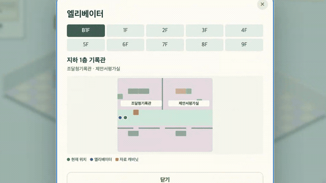

# 조달의 달인

신입 주무관 조달달의 첫 의뢰는 새봄도서관에서 보낸 모니터 20대 구매 요청서입니다. 납품기한이 비어 있습니다. 첫 업무는 새봄도서관 사서에게 전화해 그 빈칸을 채우는 일입니다.

## 게임 실행하기

**[Windows x64 실행 파일 다운로드](https://github.com/yeony-park/jodal-quest/releases/download/v0.1.0-preview.1/JodalQuest-Windows-x64.exe)** · [첫 프리뷰 릴리스](https://github.com/yeony-park/jodal-quest/releases/tag/v0.1.0-preview.1)

1. Windows에서 내려받은 `JodalQuest-Windows-x64.exe`를 더블클릭하세요. 기본 브라우저에 게임이 열립니다.
2. **게임 시작하기**를 누르세요. 대상 이름을 클릭하면 캐릭터가 그곳으로 걸어갑니다. 대사는 **Space**로 넘깁니다.
3. 다음에 같은 EXE를 같은 브라우저로 열고 **이어서 하기**를 누르면 마지막에 저장한 업무부터 계속합니다.

**Mac 등에서 브라우저로 실행하려면** [게임 소스 ZIP](https://github.com/yeony-park/jodal-quest/archive/refs/tags/v0.1.0-preview.1.zip)을 내려받아 압축을 풀고 폴더 안의 `dist/index.html`을 여세요. 게임 파일과 글꼴은 `dist` 안에 함께 들어 있습니다. 비공개 저장소의 다운로드는 접근 권한이 있는 GitHub 계정으로 로그인해야 합니다.

## 60초 예고편

[](https://github.com/yeony-park/jodal-quest/releases/download/v0.1.0-preview.1/JodalQuest-Trailer-crossfade.mp4)

**[예고편 MP4 다운로드 · 60초 · 소리 있음](https://github.com/yeony-park/jodal-quest/releases/download/v0.1.0-preview.1/JodalQuest-Trailer-crossfade.mp4)** · [1080p](https://github.com/yeony-park/jodal-quest/releases/download/v0.1.0-preview.1/JodalQuest-Trailer-1080p.mp4) · [첫 편집본](https://github.com/yeony-park/jodal-quest/releases/download/v0.1.0-preview.1/JodalQuest-Trailer.mp4)

장면이 바뀌는 열 곳은 0.3초 동안 앞뒤 장면이 겹치며 넘어갑니다. 1080p 파일은 같은 영상을 1920x1080으로 확대한 것입니다.

첫 출근한 조달달의 표정부터 납품 당일 모자란 한 대까지, 실제 플레이에 픽셀 컷을 더했습니다. 43초부터는 정파·캐비닛 수집왕·사파의 세 갈래 보상을 볼 수 있습니다. 영상 자막에는 [Galmuri](https://github.com/quiple/galmuri) 글꼴을 썼습니다.

## 플레이할 때 눈여겨볼 두 장면

**가방에서 직접 건네는 요청서.** 한서진 사서에게 확인한 납품기한을 기억해 두세요. 내 책상으로 돌아와 가방에서 요청서를 골라 내면, 방금 나눈 대화가 서류의 한 줄이 됩니다. [플레이 영상 MP4](https://github.com/yeony-park/jodal-quest/releases/download/v0.1.0-preview.1/first-request.mp4)


**7층 도서실의 캐비닛.** 엘리베이터에서 7층을 골라 보세요. 도서실 캐비닛에서 찾은 ‘용역’ 카드가 내 수첩에 남습니다. 층마다 다른 카드를 모으면 엔딩에서 수집 칭호도 받을 수 있습니다. [플레이 영상 MP4](https://github.com/yeony-park/jodal-quest/releases/download/v0.1.0-preview.1/cabinet.mp4)



## 누가 무엇을 만들었나요?

| 기여자 | 맡은 작업 | 제작 기록 |
| --- | --- | --- |
| yeony-park (Yeonjeong Park) | 첫 플레이 버전의 사무실·캐릭터·퀘스트와 게임 코드 구조를 만들었습니다. 이후 청사 10개 층과 캐비닛 수집, 배경음악·효과음, 시작 화면과 엔딩 인물평을 추가하고 Windows 실행 파일과 플레이 영상·예고편을 제작했습니다. | [첫 플레이 버전](https://github.com/yeony-park/jodal-quest/commit/7e42b1d) · [청사 탐색과 엔딩](https://github.com/yeony-park/jodal-quest/pull/4) · [Windows 빌드](https://github.com/yeony-park/jodal-quest/actions/runs/44974824971) |
| hyonsho | 계약·납품 구간을 추가해 여섯 퀘스트를 완성하고, 가방 서류 제출, 실수 수습, 조달달의 녹음 기반 대화, 경험치·레벨과 모바일 조작을 구현했습니다. 플레이 테스트를 바탕으로 목표 안내와 나라장터 문구도 다듬었습니다. | [퀘스트 확장](https://github.com/yeony-park/jodal-quest/pull/1) · [플레이 테스트 반영](https://github.com/yeony-park/jodal-quest/pull/2) · [나라장터 문구](https://github.com/yeony-park/jodal-quest/pull/3) |

조달달과 욘 대리의 목소리에는 팀에서 제공한 녹음을 사용했습니다. 녹음 제작 기록은 캐릭터별로 남아 있습니다. [팀원 음성 안내](docs/팀원음성안내.txt)

## 다음 개발 요청

**납품 수량이 어긋나는 순간을 게임 안에서도 연출해 주세요.** 여섯 번째 퀘스트에서 조달달은 계약한 모니터 20대 중 19대만 도착한 걸 발견합니다. 표정과 연출 타이밍은 [도트 예고편 00:35–00:40](https://github.com/yeony-park/jodal-quest/releases/download/v0.1.0-preview.1/JodalQuest-Trailer.mp4)을 참고해 주세요.

- [x] **화면 흔들림** — ‘실제 도착 19대’가 처음 보일 때 화면을 짧게 한 번 흔들어 주세요. 부족분을 보완한 뒤 20대를 다시 확인할 때는 평소처럼 보여 주세요. [납품 확인 장면의 `delivery()`](src/game/procurement.js)
- [x] **조달달 얼굴 줌인** — 흔들림 직후 놀란 조달달의 얼굴을 도트가 선명하게 보이도록 확대해 주세요. 표정이 한 박자 보인 뒤 납품 자료로 돌아와 플레이어가 보완 요청을 고를 수 있게 해 주세요. [캐릭터 초상화의 `face()`](src/world/characters.js)

**플레이 확인** — PC와 휴대폰에서 연출이 끝나면 계약 수량과 도착 수량을 다시 읽고 ‘부족분 보완을 요청한다’를 누를 수 있어야 합니다. 기기의 ‘동작 줄이기’를 켜면 놀란 표정을 정지 컷으로 보여 주세요.

## 플레이

1. 5층에서 수요기관에 빠진 납기를 확인하고 요청서를 보완합니다.
2. 선배 김주문에게 조언을 듣고 필요한 성능으로 규격을 수정합니다.
3. 업무용 모니터에서 공고 초안의 수량을 고치고, 선배 검토와 담당자 결재를 거쳐 게시합니다.
4. 공급기업 담당자 욘 대리로 전환해 제품·참가 조건을 확인하고 모의 입찰서를 제출합니다.
5. 조달달로 돌아와 엘리베이터로 2층에 갑니다. 입찰 전에 결정한 예정가격과 심사 결과를 확인하고 담당자의 전자계약 체결을 배웁니다.
6. 5층에서 납품 부족분을 보완하고 검사·검수, 물품인수와 영수증·납품 서류 확인 후 대금 지급 절차를 마칩니다.

한글 입력 상태에서도 방향키 / WASD로 이동합니다. 수동·자동 이동 속도는 모두 초당 145입니다. 대상 이름이나 화면의 ‘다음 목표로 이동’을 누르면 자동으로 걸어갑니다.
다른 층의 목표는 엘리베이터로 안내합니다. 휴대전화에서는 방향 버튼을 길게 눌러 이동하고 ‘대화’를 눌러 상호작용합니다.
Space는 문장 전체 보기·다음 대사, Q는 퀘스트 노트입니다. ‘용어 수첩’과 엔딩의 여섯 업무 복습을 이용하세요.

가방은 사원증·요청서·규격서·공고문·접수증·계약서·완료철의 7칸입니다.
업무 대상이 서류를 요청하면 강조된 가방에서 물건을 눌러 제출합니다. 다른 서류를 내면 인물의 힌트를 받고 감점 없이 다시 고릅니다.
요청서는 첫 설명 뒤, 규격서는 두 번째 업무에서 초안으로 받습니다. [서류 제출표](docs/ITEM_SUBMISSIONS.md)에 11개 제출 단계를 기록했습니다.
선택지에는 결정 문장만 표시합니다. 잘못된 선택은 결과를 본 뒤 수습 업무로 올바른 절차를 마칩니다.
수습 0개는 정파, 1~2개는 정파 · 수습을 배운 신입, 3개 이상은 사파 칭호를 받으며 엔딩 줄 노트에 인물평과 캐비닛 카드 수집 칭호를 표시합니다. 이전 저장의 오답 횟수도 칭호에 반영합니다.
상호작용 대상의 밝은 테두리와 이름은 두 칸 이내에서 표시합니다. 다음 목표 이름과 미니맵 점은 거리와 관계없이 표시하고 목표 이름만 깜박입니다. 동작 줄이기 설정에서는 깜박임을 끕니다.
모의 입찰서 접수 뒤 별도 심사와 계약 절차가 이어집니다. 인물·기관·기업·제품·금액·문서는 가상 설정입니다.
실제 업무와 다를 수 있다는 안내는 시작 화면의 물음표 도움말과 엔딩에 표시합니다. 업무 중에는 날짜·시간을 표시합니다.
미니맵을 누르면 층별 지도가 열립니다. 엘리베이터를 타고 지하 1층부터 9층까지 둘러보며 자료 캐비닛에서 용어 카드 10장을 모을 수 있습니다.
퀘스트마다 100 XP를 받고 수습 없이 마치면 25 XP를 더 받습니다. 150 XP마다 레벨이 오르며 레벨 배지 옆에서 경험치를 확인합니다. 엔딩은 최종 레벨을 표시합니다.

## 저장과 소리

저장 키 `jodal-master-v1`, 버전 1을 유지합니다. 기존 stage 4 저장은 새 계약 퀘스트부터 이어집니다. 경험치가 없는 이전 저장에는 완료한 퀘스트당 100 XP를 부여합니다.
같은 브라우저·같은 주소에서 이어하기를 이용하세요. 퀘스트·확인 항목·현재 층·수습 기록·진행 중인 수습·경험치·2층 배웅 대화 완료 여부를 저장합니다. 위치와 로그인은 실행할 때 초기화합니다.

조달달은 사용자가 제공한 녹음, 욘 대리는 기존 팀원 녹음의 발성 조각을 사용합니다. 김주문과 다른 인물은 합성 발성 효과를 사용합니다.
두 음성 뱅크를 JavaScript에 내장해 파일 직접 실행에서도 재생합니다. 조달달로 플레이하는 대화마다 그 대화에 맞는 조달달의 짧은 답변이 이어집니다. 두 녹음의 기본 재생 속도는 1.4이며 대화 음성·배경음악·효과음은 각각 켜거나 끌 수 있습니다. 배경음악 음량은 0~100으로 조절합니다.
원본 전체 녹음은 배포하지 않고 가공한 발성 조각을 JavaScript에 내장합니다. 사용자가 제공한 조달달 발성 조각 24개를 추가했습니다.
기존 Gaegu Regular 글꼴의 허가문은 `assets/FONT-LICENSE.txt`와 `dist/FONT-LICENSE.txt`에 있습니다.

## 개발과 검증

Node.js 22 이상에서 실행합니다. 개발 의존성은 lockfile로 고정한 esbuild 하나입니다.

```sh
npm ci
npm run dev   # http://127.0.0.1:8765
npm test      # 빌드 + 게임 검사 + 배포 자산 검사
npm run build # dist 재생성
```

`src`를 수정하고 빌드하세요. `dist`는 자동 생성 결과이며 저장소에 포함합니다.
`src/styles/index.css`의 CSS import 순서는 유지하세요.

Windows에서 배포본을 다시 패키징하려면 저장소 루트에서 PowerShell로 `.\packaging\windows\build.ps1`을 실행하세요. 결과는 `release/JodalQuest-Windows-x64.exe`입니다.

`src/components`는 화면, `src/game`은 퀘스트·입력, `src/world`는 Canvas·이동, `src/data`는 퀘스트·학습·층 배치, `src/core`는 상태·저장, `src/audio`는 소리입니다.
추가 계약·납품 로직은 `src/game/procurement.js`, 학습 자료는 `src/data/learning.js`에 있습니다.

게임 검사 98개와 배포 자산 검사가 통과했습니다. 캐릭터의 각 자세 연결, 픽셀 정렬, 청사 층간 이동, 저장 호환, 여섯 퀘스트, 터치 입력, 독립 음성 뱅크를 검사합니다.
브라우저 실기 결과와 남은 확인은 [검증 기록](docs/검증기록.txt)에 기록합니다.

- [개발 인수인계](docs/HANDOFF.md)
- [실행 안내](docs/실행안내.txt)
- [음성 안내](docs/팀원음성안내.txt)
- [1분 시연 구성](docs/1분시연동선.txt)
- [제출 소개문 초안](docs/제출용소개문-초안.txt)

공식 참고 자료는 2026-11-21 확인 기준입니다.
[조달청 총액계약 업무처리절차](https://www.pps.go.kr/kor/content.do?key=00179), [조달청 층별배치도](https://www.pps.go.kr/kor/content.do?key=00139), [나라장터](https://www.g2b.go.kr/)를 참고했습니다.
맵은 본청의 층별 대표 공간을 재구성했습니다. 2층 계약팀은 게임 전용 공간이고 엔딩 외부 링크는 [조달청 채용정보](https://www.pps.go.kr/kor/bbs/list.do?key=00645)입니다.
이 게임은 2026 조달청 AI 게임·콘텐츠 공모전 AI 게임 부문 출품을 위해 제작했습니다.
