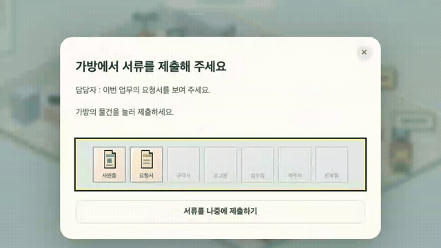

<h1 align="center">조달의 달인</h1>

<p align="center"><strong>첫 출근, 첫 의뢰, 그리고 첫 위기.</strong></p>
<p align="center">신입 주무관의 첫 업무를 따라가는 픽셀 아트 어드벤처 RPG</p>

[](https://github.com/yeony-park/jodal-quest/releases/download/v0.1.0-preview.1/JodalQuest-Trailer-crossfade.mp4)

<p align="center">
  <a href="https://github.com/yeony-park/jodal-quest/releases/download/v0.1.0-preview.1/JodalQuest-Trailer-crossfade.mp4"><strong>▶ 60초 예고편</strong></a>
  &nbsp; · &nbsp;
  <a href="https://github.com/yeony-park/jodal-quest/releases/download/v0.1.0-preview.1/JodalQuest-Windows-x64.exe"><strong>Windows 게임 다운로드</strong></a>
  &nbsp; · &nbsp;
  <a href="#게임-시작하기">Mac 및 브라우저 실행</a>
</p>

---

## PROLOGUE. 신입 주무관 조달달입니다!

오늘은 조달달의 첫 출근 날.

새봄지방조달청 5층, 엘리베이터 문이 열리고 선배 김주문이 당신을 맞이합니다.

책상 위에 놓인 첫 번째 구매 요청서.

**새봄도서관에서 모니터 20대가 필요하다고 합니다.**

그런데 어라, 납품기한이 비어 있습니다.

전화 한 통이면 끝날 줄 알았던 첫 업무는 규격 검토, 입찰, 계약으로 이어집니다. 이제 모든 일이 순조롭게 끝나는가 싶었는데…

> 20대를 주문했는데, 왜 19대만 도착한 거죠?

첫 업무부터 찾아온 위기. 당신은 무사히 일을 마칠 수 있을까요?

## CHAPTER 01. 서류 한 장에서 시작된 모험



사원증 하나 들고 시작한 신입 생활. 선배에게 조언을 구하고, 직접 전화를 걸고, 필요한 정보를 찾아 빈칸을 채워 보세요.

가방 속 요청서와 규격서, 공고문은 퀘스트를 진행할수록 하나씩 늘어납니다. 서류를 꺼내 상대에게 직접 건네야 다음 업무가 시작됩니다.

무엇을 확인하고, 어떤 서류를 제출할지 결정하는 사람은 바로 당신입니다.

[첫 업무 플레이 영상 보기 (MP4)](https://github.com/yeony-park/jodal-quest/releases/download/v0.1.0-preview.1/first-request.mp4)

## CHAPTER 02. 잠깐, 이번엔 제가 기업 담당자라고요?

공고가 게시되는 순간, 이야기는 다른 사람의 시점으로 넘어갑니다.

방금까지 구매 요청을 처리하던 조달달. 이제는 공급기업의 **욘 대리**가 되어 그 공고를 살펴봅니다.

어떤 제품이 조건에 맞을까요? 우리 회사도 입찰에 참여할 수 있을까요?

같은 공고를 서로 다른 입장에서 바라보며, 하나의 물품이 공공기관에 도착하기까지의 여정을 경험합니다.

| QUEST | 오늘의 업무 |
| :--- | :--- |
| 01 · 구매 요청 | 사라진 납품기한을 찾아라! |
| 02 · 규격 검토 | 정말 필요한 조건은 무엇일까? |
| 03 · 입찰 공고 | 공고문을 완성하고 게시하라! |
| 04 · 기업 입찰 | 욘 대리가 되어 모의 입찰에 참여하라! |
| 05 · 계약 | 입찰 이후에는 어떤 일이 벌어질까? |
| 06 · 납품 | 도서관의 모니터 20대를 사수하라! |

## CHAPTER 03. 청사 곳곳에 숨겨진 이야기를 찾아보세요


잠시 업무에서 벗어나 엘리베이터를 타고 청사를 둘러보세요.

[청사 탐색 플레이 영상 보기 (MP4)](https://github.com/yeony-park/jodal-quest/releases/download/v0.1.0-preview.1/cabinet.mp4)

## CHAPTER 04. 정파인가, 사파인가

실수 없는 업무 처리의 달인? 캐비닛을 놓치지 않는 수집왕? 아니면 선배의 도움으로 위기를 넘기는 신입?

퀘스트를 직접 해결하면 경험치가 쌓이고 레벨이 올라갑니다. 잘못된 선택을 해도 이야기는 계속됩니다. 김주문 선배가 이유를 알려 주고 수습을 도와줍니다.

모든 업무가 끝나면 그동안의 선택과 탐험 기록에 따라 칭호와 인물평을 받습니다.

**당신의 첫 출근은 어떤 평가로 기억될까요?**

---

## 게임 시작하기

현재 배포 버전: **v0.1.0-preview.1**

**[Windows x64 다운로드](https://github.com/yeony-park/jodal-quest/releases/download/v0.1.0-preview.1/JodalQuest-Windows-x64.exe)** · [전체 릴리스 파일](https://github.com/yeony-park/jodal-quest/releases/tag/v0.1.0-preview.1)

- **Windows:** 내려받은 `JodalQuest-Windows-x64.exe`를 더블클릭하면 기본 브라우저에서 게임이 열립니다.
- **Mac 및 기타 환경:** [ZIP 다운로드](https://github.com/yeony-park/jodal-quest/archive/refs/tags/v0.1.0-preview.1.zip) 후 압축을 풀고 `dist/index.html`을 브라우저에서 여세요. 게임 파일과 글꼴은 `dist` 폴더에 포함되어 있습니다.

시작 화면에서 **게임 시작하기**를 누르면 첫 출근이 시작됩니다. 이전에 플레이했다면 같은 브라우저와 주소에서 **이어서 하기**를 선택하세요.

### 조작 방법

| 조작 | 방법 |
| :--- | :--- |
| 이동 | 방향키 / WASD · 모바일 방향 버튼 |
| 달리기 | 같은 방향을 두 번 빠르게 누르고 유지 |
| 목적지로 이동 | 대상 이름 또는 '다음 목표로 이동' 클릭 |
| 대화 | 대상과 상호작용 · 모바일 '대화' 버튼 |
| 대사 넘기기 | Space |
| 선택지 | 클릭 / 터치 또는 ↑↓ + Enter |
| 퀘스트 노트 | Q |
| 서류 제출 | 가방에서 서류를 끌어 놓거나 펼치기·건네기 선택 |
| 청사 탐색 | 엘리베이터 · 미니맵 확대 |

대화 음성, 배경음악, 효과음은 각각 설정에서 조절할 수 있습니다.

예고편에는 실제 플레이와 픽셀 아트 연출을 함께 담았습니다. [예고편 MP4 · 60초 · 소리 있음](https://github.com/yeony-park/jodal-quest/releases/download/v0.1.0-preview.1/JodalQuest-Trailer-crossfade.mp4) · [1080p 버전](https://github.com/yeony-park/jodal-quest/releases/download/v0.1.0-preview.1/JodalQuest-Trailer-1080p.mp4)

## 만드는 사람들

우리가 매일 사용하는 공공시설의 물건은 어떤 과정을 거쳐 그곳에 놓이게 될까요?

조달의 달인은 이 질문에서 출발한 게임입니다. 낯선 조달 업무를 직접 수행하는 퀘스트로 풀어내고, 공무원과 공급기업 양쪽의 시점에서 공공조달의 흐름을 경험하도록 기획했습니다.

2026 조달청 AI 게임·콘텐츠 공모전 AI 게임 부문 출품을 위해 제작했습니다.

| 박연정 | 박현석 |
| :---: | :---: |
| 팀장 | 팀원 |
| 욘 대리 | 조달달 |
| [@yeony-park](https://github.com/yeony-park) | [@hyonsho](https://github.com/hyonsho) |

조달달과 욘 대리의 목소리에는 팀에서 제공한 녹음을 사용했습니다. 예고편 자막에는 [Galmuri](https://github.com/quiple/galmuri) 글꼴을 사용했습니다.

<details>
<summary>개발 및 실행 환경</summary>

Node.js 22 이상이 필요합니다.

```sh
npm ci
npm run dev   # http://127.0.0.1:8765
npm test      # 빌드 및 게임·배포 자산 검사
npm run build # dist 재생성
```

소스 코드는 `src`에 있으며, `dist`는 빌드된 브라우저 실행 파일입니다. Windows 배포본은 PowerShell에서 `.\packaging\windows\build.ps1`을 실행해 생성합니다.

| 경로 | 역할 |
| :--- | :--- |
| `src/components` | 게임 화면 |
| `src/game` | 퀘스트 및 입력 |
| `src/world` | Canvas 렌더링 및 이동 |
| `src/data` | 퀘스트, 학습 자료, 층 배치 |
| `src/core` | 상태 및 저장 |
| `src/audio` | 음성 및 사운드 |

기존 Gaegu Regular 글꼴의 허가문은 [assets/FONT-LICENSE.txt](assets/FONT-LICENSE.txt)에서 확인할 수 있습니다.

</details>

## 참고 자료

- [조달청 총액계약 업무처리절차](https://www.pps.go.kr/kor/content.do?key=00179)
- [조달청 층별배치도](https://www.pps.go.kr/kor/content.do?key=00139)
- [나라장터](https://www.g2b.go.kr/)

공식 자료 확인 기준일: 2026년 11월 21일.

본 게임의 인물, 기관, 기업, 제품, 금액 및 문서는 가상 설정입니다. 청사와 업무 절차는 학습과 게임 진행을 위해 재구성했으며 실제 조달 업무와 다를 수 있습니다. 실제 나라장터 입찰이나 계약이 이루어지지 않습니다.

---

<p align="center"><strong>자, 이제 출근할 시간입니다.</strong></p>
<p align="center"><a href="https://github.com/yeony-park/jodal-quest/releases/tag/v0.1.0-preview.1">조달의 달인 · 게임 다운로드</a></p>
